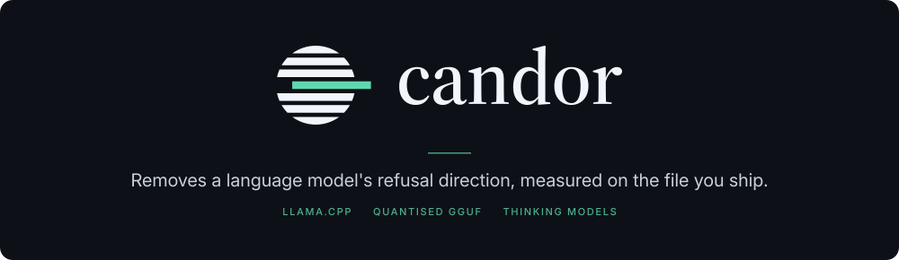
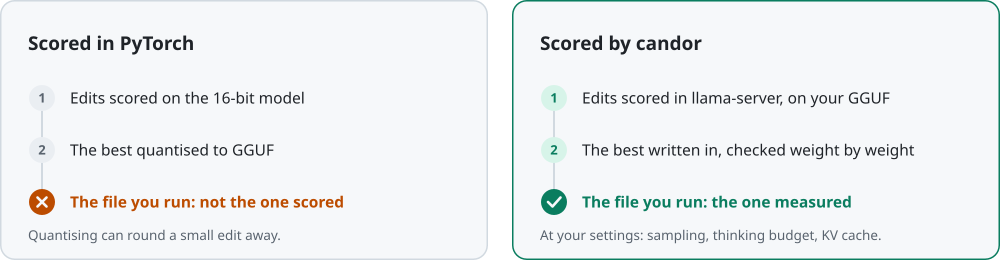
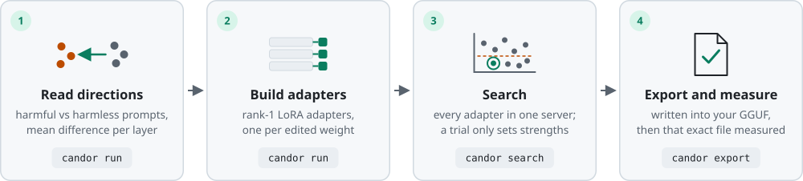
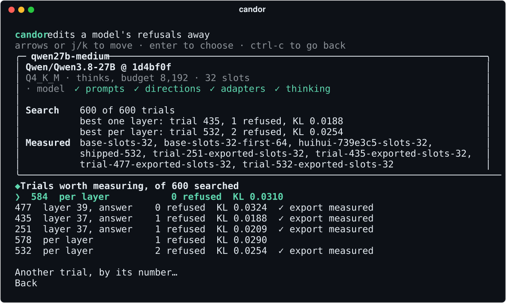

<p align="center">
  
</p>

<p align="center">
  <a href="#why">Why</a> ·
  <a href="#how-it-works">How it works</a> ·
  <a href="#quick-start">Quick start</a> ·
  <a href="#commands">Commands</a> ·
  <a href="#released-models">Released models</a> ·
  <a href="#docs">Docs</a>
</p>

candor removes a language model's refusal direction. It scores every candidate edit the way you
actually run the model: in llama.cpp, on the quantised GGUF you ship, at your settings. The file it
hands you is the file it measured.

> [!NOTE]
> Answers to harmful prompts are only ever written to a run's `private/` folder. Commands print
> counts and measurements, never generated text.

## Why

An edit that works on the 16-bit model in PyTorch is not yet the model people run. Quantising can
round part of a small edit away: on rude-llama, Q4_K_M kept 55-98% of one edit's change, and its
refusals came back. So candor never scores a stand-in.

<picture>
  <source media="(prefers-color-scheme: dark)" srcset="docs/images/why-dark.svg">
  
</picture>

## How it works

<picture>
  <source media="(prefers-color-scheme: dark)" srcset="docs/images/pipeline-dark.svg">
  
</picture>

1. **Read directions.** Read the residual stream for harmful and harmless prompts with
   transformers, once, and take the difference of means per layer. llama-server itself tokenizes the
   prompts, so the directions see exactly the input that scoring and your apps use.
2. **Build adapters.** Turn the edit into rank-1 LoRA adapters, one per edit target (each weight that
   writes into the residual stream) for each candidate direction, in the layout llama.cpp's
   converter gives them.
3. **Search.** Load them all into llama-server and score each candidate by setting per-layer
   strengths per request, so nothing is re-converted between trials. A "full" edit
   (`edit.row_norm`) isn't linear in strength, so each candidate instead gets an adapter of its own
   and the server restarts.
4. **Export and measure.** Write the chosen edit into a copy of the model's GGUF, every other tensor
   untouched, quantise it as you run it, and measure that exact file.

## Quick start

You need an Apple Silicon Mac or an x86-64 Linux machine with an NVIDIA GPU (CUDA 12.8 or newer),
and [uv](https://docs.astral.sh/uv/).

```
uv sync
uv run candor
```

With no command, `candor` opens menus: every run with how far it has got, and for each run the next
step, already chosen. Each choice shows the command it runs.

<p align="center">
  
</p>

Or step by step:

```
uv run candor inspect meta-llama/Llama-3.2-3B-Instruct              # can candor edit it? No GPU needed
uv run candor init llama --model meta-llama/Llama-3.2-3B-Instruct   # writes runs/llama/candor.toml
uv run candor run runs/llama                                        # directions and adapters
uv run candor search runs/llama                                     # find the best edit, overnight
uv run candor measure runs/llama --trial 37                         # a trial it names, on held-out prompts
uv run candor export runs/llama --trial 37                          # write it into the GGUF you run
uv run candor measure runs/llama --trial 37 --exported              # measure that exact file
uv run candor serve runs/llama --trial 37                           # chat with it
```

Before the first run:

- **Prompts.** The held-out harmful prompts come from StrongREJECT, which is gated: accept its terms
  on its Hugging Face page, then `hf auth login`.
- **llama.cpp** (release b11524) is fetched once into `~/.cache/candor`, or `CANDOR_CACHE`: the
  binaries, checked by sha256, and its converter in its own environment, pinned by
  `src/candor/data/converter-constraints.txt`. `CANDOR_LLAMA_BIN` points at an existing b11524 build
  instead.
- **Big models.** Reading residuals needs the model in 16 bits on the GPU. A 3B model fits on an
  18 GB Mac; larger ones and long jobs run on a [pod](docs/pods.md).

## Commands

| Command | What it does |
| :--- | :--- |
| `candor` | [Menus](docs/commands.md#the-menus) for everything below |
| [`inspect`](docs/commands.md#inspect) | Check a model before spending anything on it |
| [`init`](docs/commands.md#init) | Start a run: check the model and write its settings |
| [`run`](docs/commands.md#run) | Build every stage the search needs, reusing what is built |
| [`upgrade`](docs/commands.md#upgrade) | Bring a run's `candor.toml` up to this version's settings |
| [`search`](docs/commands.md#search) | Find the smallest edit that leaves almost no refusals |
| [`proxy`](docs/commands.md#proxy) | Check if a thinking model may be searched with thinking off |
| [`score`](docs/commands.md#score) | Score one edit as the search scores its trials |
| [`measure`](docs/commands.md#measure) | Measure the unedited model or a trial, on prompts and maths |
| [`compare`](docs/commands.md#compare) | Compare two measurements prompt by prompt |
| [`export`](docs/commands.md#export) | Write a trial's edit into the GGUF you run |
| [`serve`](docs/commands.md#serve) | Chat with the unedited model or a trial's export, as measured |

candor measures other tools' edits like its own: [heretic](https://github.com/p-e-w/heretic)'s
trials, rebuilt from its study ([`--heretic`](docs/commands.md#heretics-trials)), and any edited copy
of the model ([`--outside`](docs/commands.md#export)).

## Released models

Each is the export candor measured.

| Model | Thinking | Trial | Download | Results |
| :--- | :--- | ---: | :--- | :--- |
| Llama 3.2 3B Instruct | No | 535 | [GGUF](https://huggingface.co/candor-lab/Llama-3.2-3B-Instruct-Candor-Uncensored-GGUF) | [phase 2](results/milestone-rude-llama-vs-heretic.md) |
| Qwen3.5-9B | Yes | 175 | [GGUF](https://huggingface.co/candor-lab/Qwen3.5-9B-Candor-Uncensored-GGUF) | [phase 3](results/milestone-qwen3.5-9b-vs-heretic.md) |
| K2-Horizon-7B | Yes | 205 | [GGUF](https://huggingface.co/candor-lab/K2-Horizon-7B-Candor-Uncensored-GGUF) | [phase 4](results/phase-4-k2-horizon-7b.md) |
| Qwen3.8-27B | Yes | 532 | [GGUF](https://huggingface.co/candor-lab/Qwen3.8-27B-Candor-Uncensored-GGUF) | [phase 5](results/phase-5-qwen3.8-27b.md) |

## Docs

- **[Commands](docs/commands.md):** every command, its options and what it keeps
- **[Models](docs/models.md):** thinking models, sampling, slots, and what fits where
- **[Pods](docs/pods.md):** running big models and long jobs on Runpod
- **[Development](docs/development.md):** tests, tools and the images
- **[Brand](docs/brand.md):** the mark, colours and type, for anything visual
- **[STATUS.md](STATUS.md):** the plan: what is done, now and next
- **[results/](results/):** every measurement, finding and decision

candor is in early development. It is licensed under [Apache 2.0](LICENSE).
